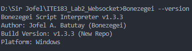
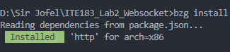
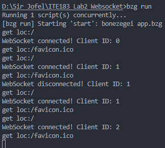
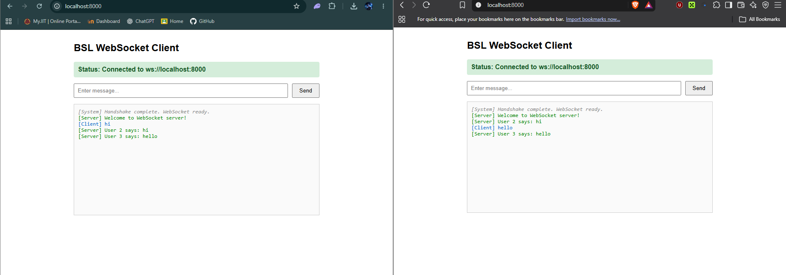
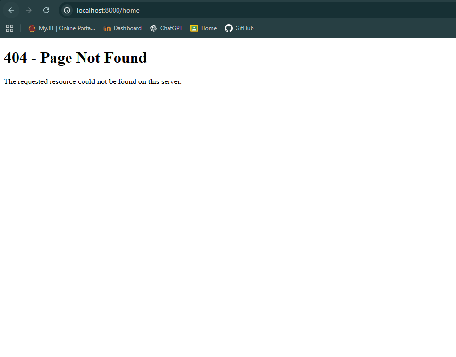
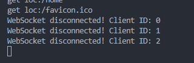

# BSL WebSocket Server

A WebSocket chat server built using the Bonezegei Scripting Language (BSL) and the BSL HTTP Library.

This project demonstrates how a WebSocket server can handle browser connections, send welcome messages, receive client messages, broadcast messages to multiple connected clients, and serve web pages through HTTP requests.

## Project Description

The BSL WebSocket Server is a simple web-based chat application developed for Laboratory Activity 2: WebSocket Server (ITE183 - Web Systems and Technologies).

The server uses the BSL HTTP Library to handle HTTP requests and WebSocket communication. It runs on port 8000 and provides the following functionality:

- `/` — displays the WebSocket chat client.
- **WebSocket connection** — establishes a persistent connection between the browser and the server.
- **Welcome message** — sends a welcome message when a client connects.
- **Message broadcasting** — sends a message from one client to all connected clients.
- **Client disconnection** — detects when a client disconnects.
- **Any unsupported route** — displays a custom 404 Not Found page.

Unlike ordinary HTTP requests, WebSockets keep a connection open between the client and server, making real-time communication possible without repeatedly sending new HTTP requests.

## Technologies Used

- Bonezegei Scripting Language (BSL)
- BSL HTTP Library
- Visual Studio Code
- Git and GitHub
- HTML
- JavaScript
- HTTP
- WebSocket
- GitHub Codespaces

## Project Structure

```
ITE183_Lab2_Websocket/
|-- .gitattributes
|-- LICENSE
|-- README.md
|-- app.bzg
|-- package.json
|-- documentation/
|   |-- version.png
|   |-- install.png
|   |-- connected.png
|   |-- communication.png
|   |-- 404.png
|   `-- disconnected.png
|-- lib/
|   `-- (generated by bzg install)
`-- public/
    |-- index.html
    `-- 404.html
```

> **Note:** The `lib/` folder and its contents are generated by the package manager and may vary depending on the operating system.

## Installation and Setup

### 1. Install Visual Studio Code

Install Visual Studio Code and use it as the development environment for the project.

Open the Extensions tab using `Ctrl + Shift + X`, search for **Bonezegei**, and install the Bonezegei Scripting Language extension.

### 2. Install the Bonezegei Interpreter

This project requires **Bonezegei v1.3.3**.

**Linux / GitHub Codespaces**

```bash
wget https://github.com/bonezegei/Bonezegei_Scripting_Language/raw/refs/heads/main/Release/Latest/Bonezegei-x86.deb
sudo apt install ./Bonezegei-x86.deb
```

**Windows:** uninstall any previous version, then search for **Bonezegei** in the Microsoft Store and install it.

Verify the installation by running:

```bash
bonezegei -v
```

The terminal should display version 1.3.3.



### 3. Open the Project

Open the `ITE183_Lab2_Websocket` repository in Visual Studio Code or GitHub Codespaces and make sure it contains these files:

- `app.bzg`
- `package.json`
- `public/index.html`
- `public/404.html`

### 4. Install the Required Library

Open a terminal in the project root directory and run:

```bash
bzg install
```

This installs the `http` library specified in `package.json` and generates the `lib/` folder.



### 5. Run the WebSocket Server

From the project root directory, run:

```bash
bzg run
```

If everything is configured correctly, the terminal should show that the HTTP server is listening on port 8000.

When using GitHub Codespaces, open the **Ports** tab and access port 8000 through its forwarded browser URL.

## Usage Instructions

Once the server is running, open `http://localhost:8000` (or the forwarded port 8000 URL in Codespaces) in a web browser. The chat client automatically uses `ws://` for HTTP and `wss://` for HTTPS.

### 1. Server Running

Run `bzg run` from the project root. The terminal displays the server startup message and confirms that the server is listening on port 8000.



### 2. Real-Time Communication Between Clients

Open the chat client in two different browsers. Each client shows its connected status and receives a welcome message from the server when it connects. Then send a message from either one. The server receives the message and broadcasts it to all connected clients, so it appears in both windows at the same time.

The screenshot below shows two clients side by side: **Google Chrome (left)** and **Brave (right)**.



This demonstrates real-time communication between multiple clients through the WebSocket server.

### 3. Testing the Custom 404 Page

Open an unsupported route by adding `/test` to the URL, for example:

```
http://localhost:8000/test
```

In Codespaces, use `https://YOUR-CODESPACE-8000.app.github.dev/test` and replace the example domain with your actual URL.

The server displays the custom 404 Not Found page because the route is not mapped to the home page.



### 4. Client Disconnected

Close one of the browser windows or tabs. The server detects the disconnection and logs the client ID in the terminal.



## Server Implementation

The server is implemented in `app.bzg` and uses the BSL HTTP Library.

The server performs the following operations:

1. Initializes the server on port 8000.
2. Handles incoming HTTP requests and serves `public/index.html` for the `/` route.
3. Serves `public/404.html` for unsupported routes.
4. Detects new WebSocket connections and sends a welcome message to the connecting client.
5. Receives messages from clients and broadcasts them to all connected clients using `server.sendAll()`.
6. Detects client disconnections and logs the event in the terminal.

The browser interface is implemented in `public/index.html` using HTML and JavaScript. It connects to the server through WebSockets and displays incoming and outgoing chat messages. Because the sender's browser also receives the broadcast, a sent message appears twice: once as `[Client]` and once as `[Server] User N says: ...`.

## Troubleshooting

If the chat client cannot connect to the server, check the following:

- Make sure the server is still running in the terminal.
- Run `bzg install` before starting the server if the library has not been installed.
- Run `bzg run` from the project root directory.
- Make sure port 8000 is forwarded and accessible in GitHub Codespaces.
- Check the terminal for errors related to loading the HTTP library or starting the server.
- Run `bonezegei -v` to confirm you are on version 1.3.3.

## License

This project is licensed under the MIT License. See the `LICENSE` file for details.
